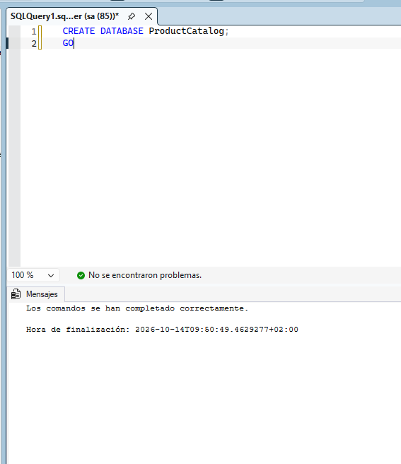
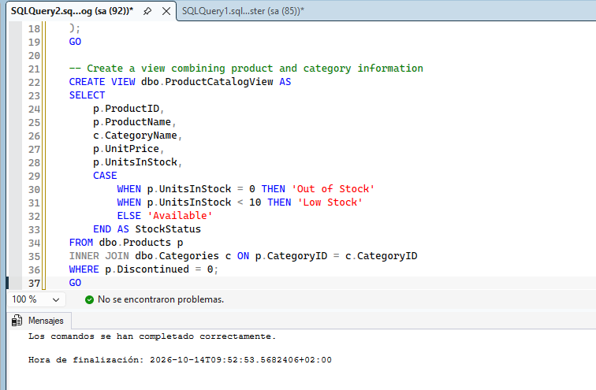
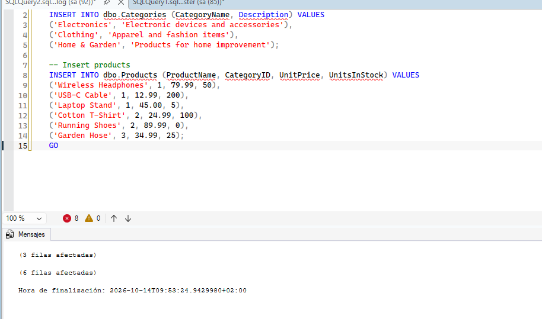
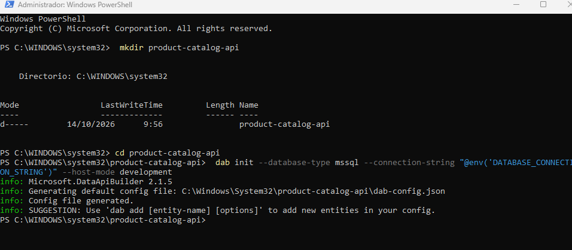
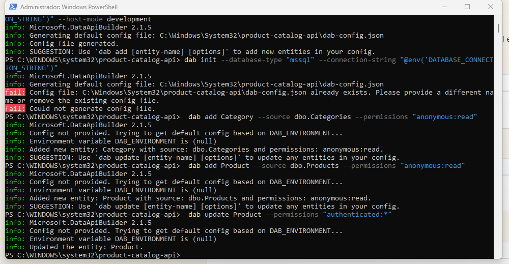
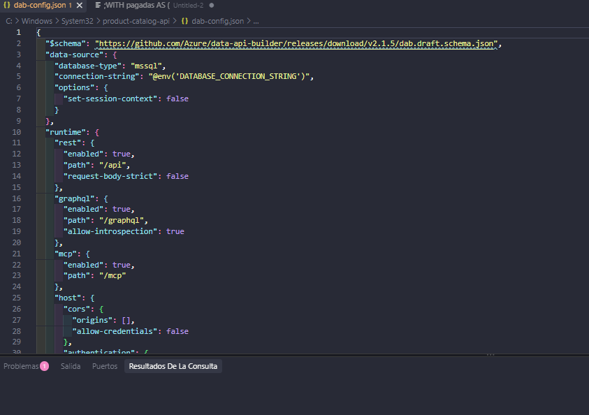
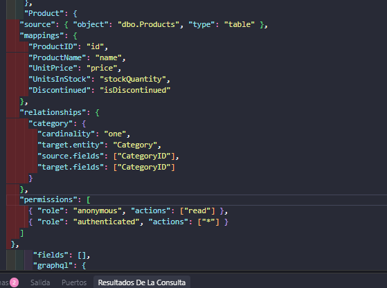
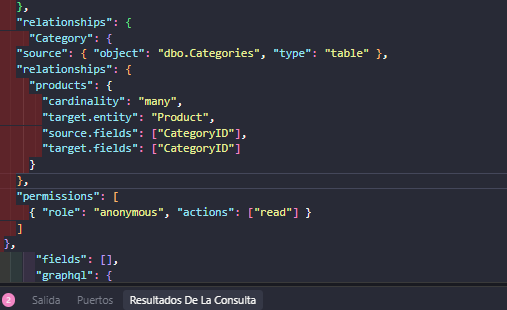
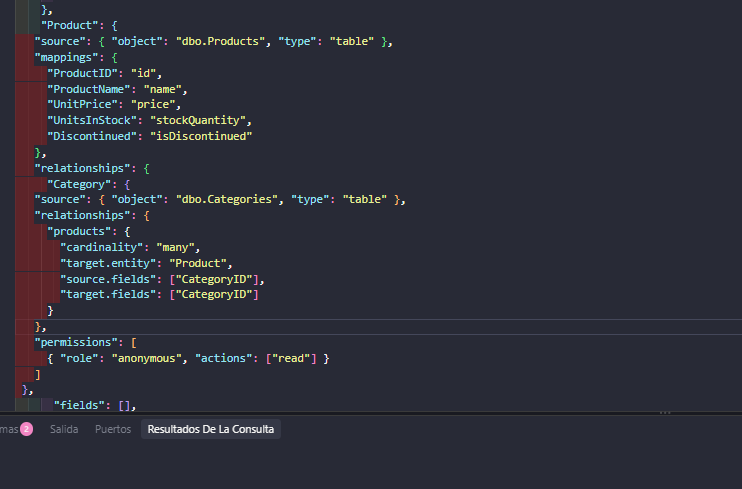

# Laboratorio 08: Integrar soluciones SQL con servicios de Azure

**Tiempo estimado: 30 minutos**

En este ejercicio, vas a crear una configuración de Data API Builder para una base de datos de un catálogo de productos y la desplegarás en Azure. Configurarás entidades para tablas y vistas, establecerás endpoints REST y GraphQL, y verificarás que la API funciona correctamente.

Eres un desarrollador de bases de datos que necesita exponer los datos del catálogo de productos a través de APIs modernas. Los desarrolladores de frontend de tu equipo requieren tanto endpoints REST para operaciones simples como GraphQL para consultas flexibles con relaciones.

## Requisitos previos

* Una suscripción a Azure.
* Azure CLI instalado y con sesión iniciada en tu suscripción.
* Un editor de código como Visual Studio Code y la extensión de SQL Server (mssql) instalada.
* Acceso a una base de datos de Azure SQL o una instancia de SQL Server.
* Dotnet SDK 8.0 o posterior instalado.

---

## Configurar la base de datos de muestra

Antes de configurar Data API Builder, necesitas una base de datos con tablas y datos de muestra.

1. Conéctate a tu SQL Server o Azure SQL Database usando SSMS o Visual Studio Code. Selecciona la base de datos **master**.
2. Crea una nueva base de datos para este ejercicio:
   ```sql
   CREATE DATABASE ProductCatalog;
   GO
   ```
   (Cambia el contexto a la nueva base de datos `ProductCatalog`).

3. Crea las tablas para el catálogo de productos:
   ```sql
   -- Crear tabla Categories
   CREATE TABLE dbo.Categories (
       CategoryID INT IDENTITY(1,1) PRIMARY KEY,
       CategoryName NVARCHAR(50) NOT NULL,
       Description NVARCHAR(200)
   );
      
   -- Crear tabla Products
   CREATE TABLE dbo.Products (
       ProductID INT IDENTITY(1,1) PRIMARY KEY,
       ProductName NVARCHAR(100) NOT NULL,
       CategoryID INT NOT NULL,
       UnitPrice DECIMAL(10,2) NOT NULL,
       UnitsInStock INT NOT NULL DEFAULT 0,
       Discontinued BIT NOT NULL DEFAULT 0,
       CONSTRAINT FK_Products_Categories 
           FOREIGN KEY (CategoryID) REFERENCES dbo.Categories(CategoryID)
   );
   GO
      
   -- Crear una vista combinando información
   CREATE VIEW dbo.ProductCatalogView AS
   SELECT 
       p.ProductID,
       p.ProductName,
       c.CategoryName,
       p.UnitPrice,
       p.UnitsInStock,
       CASE 
           WHEN p.UnitsInStock = 0 THEN 'Out of Stock'
           WHEN p.UnitsInStock < 10 THEN 'Low Stock'
           ELSE 'Available'
       END AS StockStatus
   FROM dbo.Products p
   INNER JOIN dbo.Categories c ON p.CategoryID = c.CategoryID
   WHERE p.Discontinued = 0;
   GO
   ```

4. Inserta los datos de muestra en ambas tablas para tener información base con la que interactuar.

---

## Instalar Data API Builder CLI

El CLI de DAB (Data API Builder) te ayuda a crear y gestionar archivos de configuración.

1. Abre un terminal o símbolo del sistema.
2. Instala la herramienta globalmente usando .NET:
   ```bash
   dotnet tool install --global Microsoft.DataApiBuilder
   ```
3. Verifica la instalación ejecutando `dab --version`.

---

## Crear la configuración inicial

1. Crea un nuevo directorio para el proyecto y accede a él:
   ```bash
   mkdir product-catalog-api
   cd product-catalog-api
   ```
2. Inicializa un nuevo archivo de configuración:
   ```bash
   dab init --database-type mssql --connection-string "@env('DATABASE_CONNECTION_STRING')" --host-mode development
   ```
   Esto creará un archivo `dab-config.json` básico.

---

## Añadir entidades para tablas

Agrega las tablas Categories y Products como entidades de la API.

1. Para la entidad Categoría (lectura anónima):
   ```bash
   dab add Category --source dbo.Categories --permissions "anonymous:read"
   ```
2. Para la entidad Producto (lectura anónima):
   ```bash
   dab add Product --source dbo.Products --permissions "anonymous:read"
   ```
3. Añadir permisos CRUD para usuarios autenticados:
   ```bash
   dab update Product --permissions "authenticated:*"
   ```

---

## Configurar mapeo de campos y relaciones

Mejora la entidad Product para relacionarla con Category dentro del archivo `dab-config.json`.

1. En el archivo `dab-config.json`, edita la sección de `Product` para añadir los `mappings` (para renombrar columnas) y `relationships` (para conectar con la categoría).
2. Haz lo mismo con la entidad `Category` añadiendo la relación inversa hacia múltiples `Products`.
3. Guarda los cambios del archivo JSON.

---

## Añadir la vista como entidad de solo lectura

1. Expón la vista `ProductCatalogView` mediante el CLI:
   ```bash
   dab add ProductCatalog --source dbo.ProductCatalogView --source.type view --source.key-fields "ProductID" --permissions "anonymous:read"
   ```
   *Nota: La propiedad `key-fields` es necesaria porque las vistas carecen de clave primaria explícita.*

---

